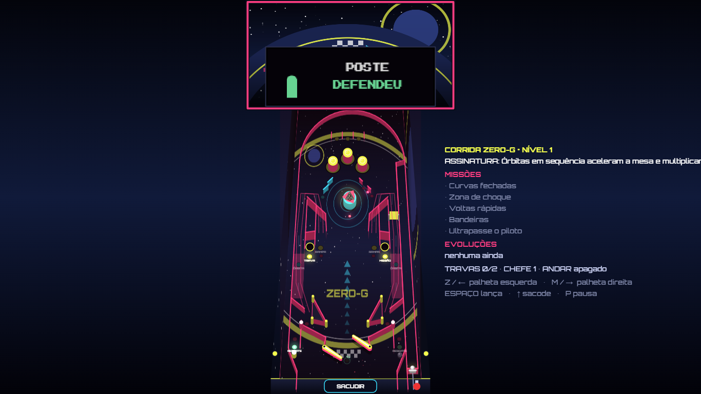
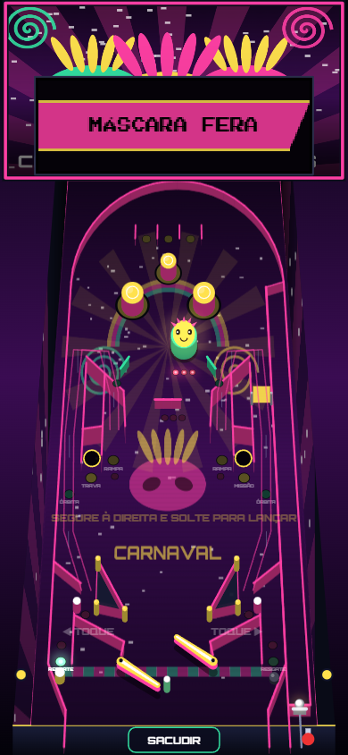
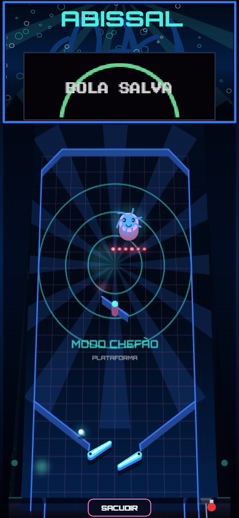
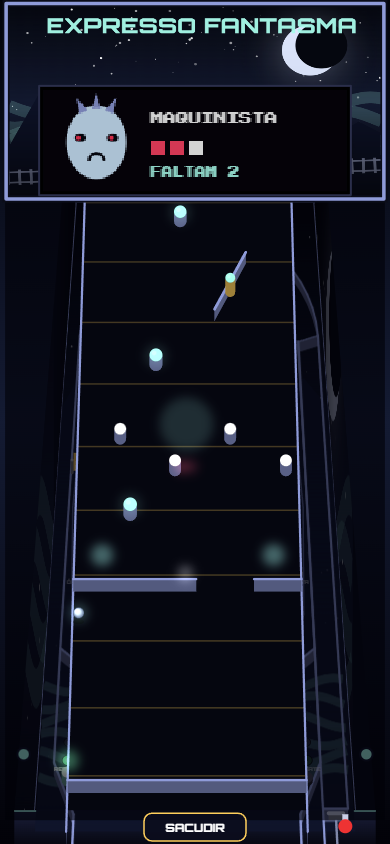
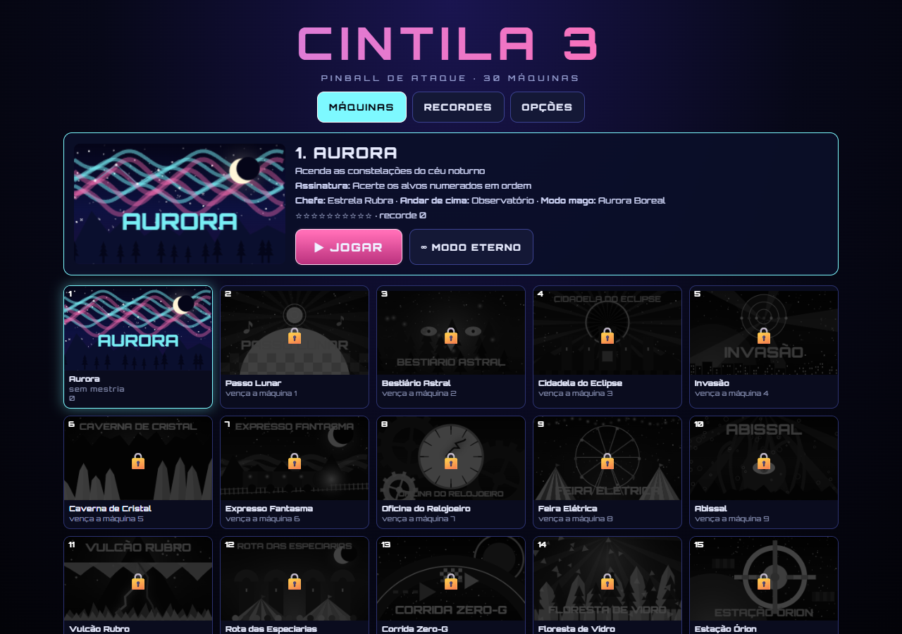

# Cintila 3 — Pinball de Ataque

Pinball em HTML5 Canvas com mesa em perspectiva 2.5D, backbox animado, um andar de cima que desce sobre a mesa e **30 máquinas** desbloqueáveis, mais modo eterno. Fator X Studio.

**Jogar:** https://cintila3.vercel.app

| Mesa (desktop) | Mesa (celular) | Andar de cima: modo chefão | Túnel mágico |
|---|---|---|---|
|  |  |  |  |



## Como se joga

| | Teclado | Celular |
|---|---|---|
| Palheta esquerda | `Z`, `A` ou `←` | toque na metade esquerda |
| Palheta direita | `M`, `L` ou `→` | toque na metade direita |
| Lançar | segure e solte `Espaço` | segure à direita e solte |
| Sacudir | `↑` | botão SACUDIR |
| Pausa | `P` ou `Esc` | — |

- Derrube as 3 fases do **chefe** para chegar ao **modo mago**. Vencer o modo mago libera a próxima máquina.
- Quando a luz **ANDAR DE CIMA** acender, suba pela **rampa direita** ou pelo **portal**.
- Cada máquina tem uma **mecânica-assinatura** própria, descrita no mapa.
- **Modo eterno:** a cada 3 minutos sobe um degrau (gravidade +2%, chefe +1 golpe, bola protegida −2 s, canaletas mais abertas). Você tem uma reserva de 3 bolas, que ganha +1 a cada degrau vencido (máx. 5); o objetivo é durar.

## Rodar

```bash
npm install
npm run dev        # http://localhost:4040
npm test           # 67 testes de regra (vitest)
npm run e2e        # teste no navegador, com o dev server ligado (usa o Chrome instalado)
npm run build      # gera dist/
```

## Arquitetura

As 30 máquinas são **dados**. O motor fica em `src/core` (física, projeção, áudio, entrada, progresso), as regras em `src/game`, o desenho em `src/render`, e cada máquina é um arquivo `src/machines/mNN_nome.ts` do tipo `MachineDef`. Acrescentar a máquina 31 é criar um arquivo e listá-lo em `src/machines/index.ts`; nada em `core/` ou `render/` precisa mudar.

- `core/physics.ts` — passo fixo de 120 Hz com 8 subpassos, colisão círculo-segmento e círculo-círculo, palhetas, portas de sentido único.
- `core/geometry.ts` — a parte de baixo da mesa (guia de retorno, entrada interna, estilingue) igual em todas as máquinas.
- `game/elements.ts` — as peças: bumper, estilingue, alvos, banco de queda, rampa, órbita, giro, portal, trava, canaletas, resgate, poste central, ímã, alvo giratório, esteira, elevador, canhão, bola cativa, roda-gigante, túnel mágico, roda de vinil, porta móvel, braço robótico, poço de areia, boca que engole, pás de moinho.
- `game/assinaturas.ts` — as 30 mecânicas exclusivas, cada uma um módulo independente (a máquina 30 sorteia seis delas por partida).
- `game/upper.ts` e `game/arena.ts` — o andar de cima (fase bônus, etapa premium, modo chefão, túnel mágico) e as subfases em campo separado.
- `render/` — tablado deformado linha a linha para o trapézio, peças com altura, bloom em meia resolução, backbox com painel de matriz de pontos de 192×64.

## Testes e números (medidos em 16/11/2026, versão 3.0.1)

| Teste | Resultado |
|---|---|
| Varredura das 30 máquinas (`test/machines.spec.ts`): joga 90 s, força andar de cima (tipo padrão e variação), 4 subfases, morte e volta do chefe, modo mago | 30 de 30 passam |
| Andar de cima entra e sai 50 vezes | 50 de 50 |
| Métricas de dreno (`test/drains.spec.ts`), robô jogando 5 min por máquina: bola acima de 20 s, entrou no andar, sem bola parada, sem NaN | 30 de 30 |
| Dreno lateral no total das 30 máquinas (meta: 4% a 8%) | 30 de 494 drenos (6,1%); com 4 sementes, 130 de 1.997 (6,5%) |
| Miolo entre as palhetas (`test/palheta.spec.ts`): vão constante de 35,5 u; bola parada em x = 186/190/194 no nível máximo | drena em 1,25 s / 0,91 s / 1,25 s (0,39 s com o poste central abaixado) |
| Áudio (`test/audio.mjs`): saída grampeada por 30 s sem tocar em nada | RMS aos 28 s abaixo de 0,04, pico 0,13, sem crescimento |
| Navegador (`test/e2e.mjs`): 30 máquinas abrem e sobem ao andar, campanha libera a máquina 2, modo eterno sobe de degrau | passa, 0 erros de console |
| Quadro em toque com CPU estrangulada e renderização por software (`SEM_GPU=1 node test/celular.mjs`) | 16,7 ms a 4× e a 6× (antes: 50 ms e 83 ms) |

## Limites conhecidos

- **Não foi testado em celular físico.** A medida de desempenho é uma emulação (CPU estrangulada, sem GPU) em desktop. Em aparelho de toque o jogo já entra em modo econômico: resolução 1×, sem bloom, menos partículas.
- **O áudio foi medido, não ouvido.** O teste grampeia a saída e confere que o nível não cresce; ninguém conferiu de ouvido depois da correção.
- **Ninguém além do robô jogou.** O equilíbrio de dificuldade vem de simulação; falta teste com pessoas.
- O dreno lateral por máquina varia muito (0% a 20%) porque cada uma tem só 5 a 35 drenos em 5 minutos; a meta é cobrada no total.
- A **Câmara Alta** é um campo separado (como as outras subfases), acionado pela rampa esquerda, e não um canto fisicamente presente na mesa.
- Este projeto foi escrito do zero a partir da especificação: o `index.html` do Cintila 2 citado nela não estava disponível, então nada foi portado.

Toda a arte, os nomes, os sons e as músicas são originais e gerados por código. Não há arquivos de imagem nem de áudio.
