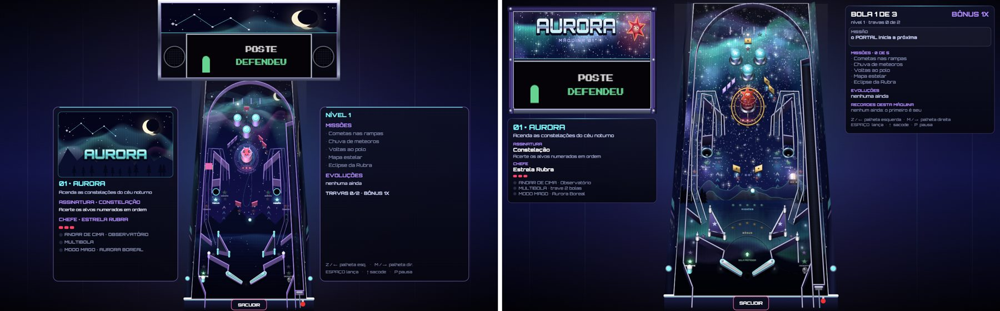
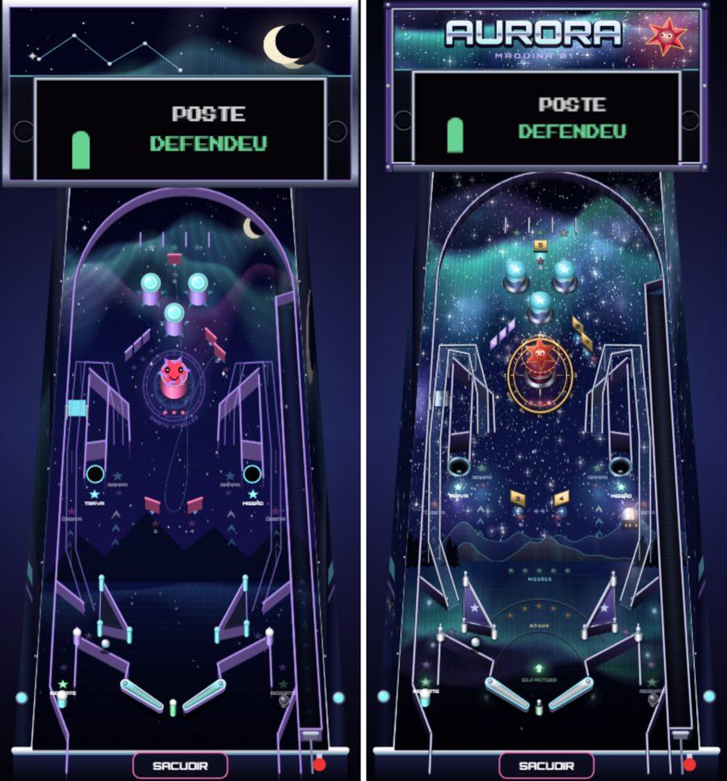
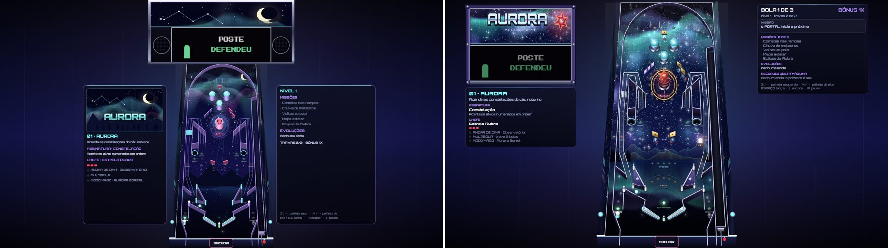

# Visual R05 · Aurora, protótipo definitivo

Branch `visual-r05`, criada a partir da `visual-r04` (árvore limpa). `main` e produção intocadas. Só a Aurora recebeu a direção R05; as outras 29 máquinas continuam com a arte R04. A exceção é o **enquadramento da tela**, que é da interface e vale para todas.

## O que mudou

### 1. Composição da tela (todas as máquinas)
- **Desktop largo ("palco"):** a mesa ocupa quase toda a altura (1440×900: 842 px de altura da mesa, antes 630, **+34%**). Proporção e geometria intactas, só a escala da vista mudou.
- O backbox saiu do topo e foi para o alto da **coluna esquerda**, com a identidade compacta da máquina logo embaixo (assinatura, chefe com vidas, andar, multibola, modo mago).
- **Coluna direita = partida:** bola e bônus, missão ativa em destaque com barra e tempo, lista de missões, evoluções, recordes. A instrução de lançamento aparece **dentro deste painel** quando há bola na canaleta, e não atravessa mais a mesa.
- Os dois painéis se ajustam ao conteúdo e **quebram linha**. Nenhum texto é cortado com reticências.
- **Celular:** backbox de 24% para 22% da altura e mesa de 72% para 74% (+2,7%). Controles e zonas de toque iguais.
- Abaixo de 1,2:1 ou sem largura para as colunas, volta o layout R04.

### 2. Sprites pré-renderizados (`src/visual/r05/sprites.ts`)
Cada objeto com material é pintado uma vez, com gradientes de várias paradas, cromo com reflexo de céu e chão, sombra de contato e elipses inclinadas, e depois só copiado a cada quadro. O cache é por escala e resolução.
- **Pop bumper:** base cromada com parafusos, corpo de plástico fumê com luz interna, saia de metal, tampa translúcida com decalque de estrela e brilho de borda. O flash real do bumper liga a versão acesa.
- **Poste de borracha**, **saucer** (aro cromado, fundo escuro, kicker), **inserto** (aro, lente facetada, núcleo e halo quando aceso) e **poça de luz**.

### 3. Skin da Aurora (`src/visual/r05/aurora.ts`)
Substitui só o **desenho** das peças. A peça, a colisão e a regra não mudam: cada função lê a peça real (posição, `flash`, `aceso`, `off`, `vida`, `dor`).
- **Estilingues:** acrílico violeta serigrafado com estrela, aro cromado, borracha branca que é empurrada para fora no chute (usa a normal real da peça) e três postes.
- **Alvos numerados da constelação:** face de plástico dourado em suporte de metal, com o número. Quando acesos ficam ciano.
- **Banco de queda:** blocos de plástico que afundam quando derrubados.
- **Rampas:** piso de acrílico translúcido, trilhos de arame cromado em três tons e colunas de apoio, tudo sobre o `caminho` real com altura.
- **Spinner:** placa cromada em suporte de arame, girando com o ângulo real.
- **Paredes:** trilho cromado com fio de luz violeta.
- **Palhetas:** brancas com borracha ciano.
- **Estrela Rubra (chefe):** pedestal cromado, estrela de rubi facetada com luz direcional, aro de ouro, núcleo incandescente, halo dourado girando e olhos que seguem a bola. A expressão muda quando ela leva golpe, e o branco do golpe vem do `dor` real.
- Os insertos genéricos da Aurora (rampa, órbita, trava, missão, faixas) passaram a ser sprites de vidro.

### 4. Tablado (`src/visual/r05/aurora-arte.ts`)
- Céu noturno com **via láctea e nebulosa por ruído fractal**, estrelas em 3 camadas (algumas com cruz de difração) e **cortinas de aurora** pintadas em baixa resolução e ampliadas (desfoque real, sem depender de `ctx.filter`).
- Cordilheira com crista de ruído suave, encostas que recebem a luz da aurora e neve nos pontos altos. O **observatório** (nome do andar de cima) aparece com a fenda acesa.
- **Lago gelado** refletindo a aurora, com ondulações, trincas, pinheiros e brilhos de gelo nas margens.
- **Astrolábio de latão** sob o chefe: anéis em relevo, 72 marcações, numerais romanos e rosa dos ventos.
- **Constelação** ligando os 5 alvos reais na ordem da mecânica, com traço **tracejado** (uma linha contínua parecia guia de bola) e estrelas gravadas.
- **Zona baixa** (antes vazia): placa gravada com insertos que mostram estado real da partida, sem colisão:
  - **5 estrelas de BÔNUS:** acendem conforme `bonusX`.
  - **5 luzes de MISSÕES:** feitas ficam acesas e a ativa pisca.
  - **Seta BOLA PROTEGIDA:** acende com `salva > 0` e pisca nos últimos 3 s.
- Setas pintadas sob as entradas reais de rampas e órbitas; canaleta do lançador em aço escovado.

### 5. Luz em camadas
Cada fonte tem motivo:
- lâmpadas sob os plásticos e ao pé das rampas, pintadas no tablado com poça;
- poça ciano sob cada bumper, que cresce no flash;
- violeta no estilingue que chutou;
- saucer com bola;
- dourado ou ciano nos alvos da vez;
- vermelho pulsando sob a Estrela Rubra, mais forte na última vida e no golpe.

As poças são sprites somados com `lighter`. O resto da mesa fica escuro de propósito, com vinheta e calmaria na zona das palhetas.

### 6. Backbox
- Backglass próprio em 3 camadas:
  - céu com nebulosa e aurora;
  - cordilheira com o observatório e a Estrela Rubra facetada no céu;
  - pinheiros e título "AURORA" em letreiro cromado com brilho ciano.
- Cabeça de gabinete premium: laterais de metal anodizado violeta com frisos, parafusos, faixa de luz no topo, bisel cromado e reflexo no vidro do painel de pontos.
- Os letreiros de evento ficaram opacos sobre a área da arte. No celular, "MODO MAGO" se misturava ao título.

## Medidas

**Mesmas condições:** `test/comparar.mjs`, Aurora, partida real lançada com Espaço e jogada com as palhetas, e um estado controlado com a bola no centro. A R04 rodou numa worktree separada.

| | R04 | R05 |
|---|---|---|
| Altura da mesa em 1440×900 | 630 px | 842 px |
| Cadência real, desktop | 16,7 ms (p95 16,8) | 16,7 ms (p95 16,8) |
| Script por quadro, Aurora, 4 bolas + 300 partículas | mediana 1,2 ms, p95 36,8 | mediana 1,5 ms, p95 17,5 |
| Cadência real, celular emulado 390×844 | 16,7 ms | 16,7 ms |
| Toque com CPU 4×, sem GPU | 60 fps | 60 fps |
| Toque com CPU 6×, sem GPU | mediana 16,7 ms | mediana 16,7 ms (3 de 3 rodadas), p95 33,4 |
| Build | 294,8 kB | 331,9 kB (113 kB gzip) |

Na primeira versão a Aurora caiu para 30 fps a 6×. Desligando etapas, o custo estava nas peças desenhadas ao vivo. Correções:
- rampas e estilingues parados ficam em cache e só são redesenhados durante o flash;
- no modo econômico saem o halo do chefe, a camada acesa constante dos bumpers e as poças de luz constantes, que já estão pintadas no tablado.

Regressão: 67 de 67 testes de regra, dreno lateral idêntico (6,1%), e2e, telas e `visual.mjs` nas 30 máquinas em 1440×900 e 390×844 (bola legível em 8 situações cada, mapa respeita bloqueio), 0 erros de console.

O gancho `medeQuadros` derruba a aba em emulação móvel **também na R04**, por isso o tempo de script do celular não foi medido por ele.

## Limitações honestas

- **Arte:** é procedural, gerada por código em Canvas 2D, com sprites gerados no carregamento. Não há imagem SVG ou WebP externa nem arte de IA, porque não havia ferramenta de geração de imagem. Fica longe de uma foto de máquina real: os materiais são convincentes nas peças grandes (bumpers, chefe, rampas) e mais simples nas pequenas (alvos, banco de queda).
- **Perspectiva:** os sprites usam elipses inclinadas (0,8) por cima de uma projeção que quase não encurta o eixo vertical. É uma licença visual, e a posição da colisão continua sendo a do círculo.
- **Andar de cima e subfases da Aurora:** usam o tablado R05 apagado, com as peças da skin. Não receberam composição própria.
- **Não validado:** celular físico, Safari e opinião de jogadores.
